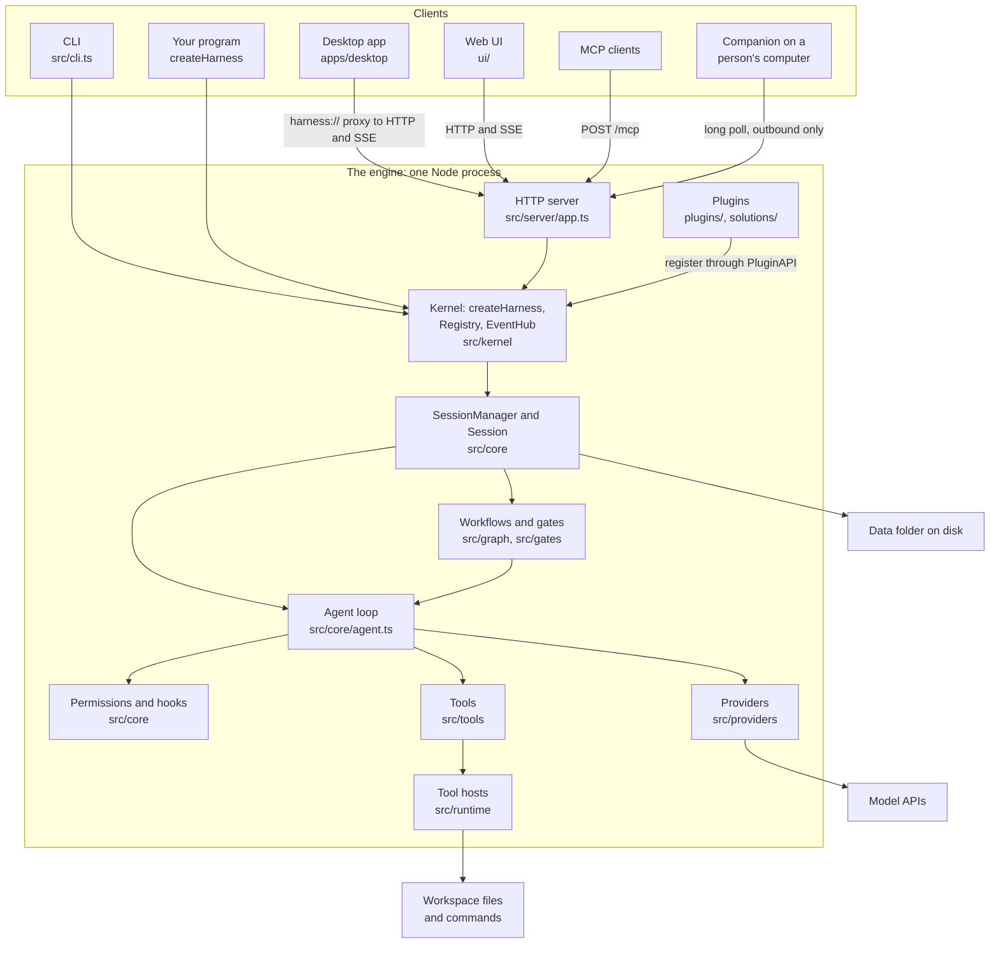
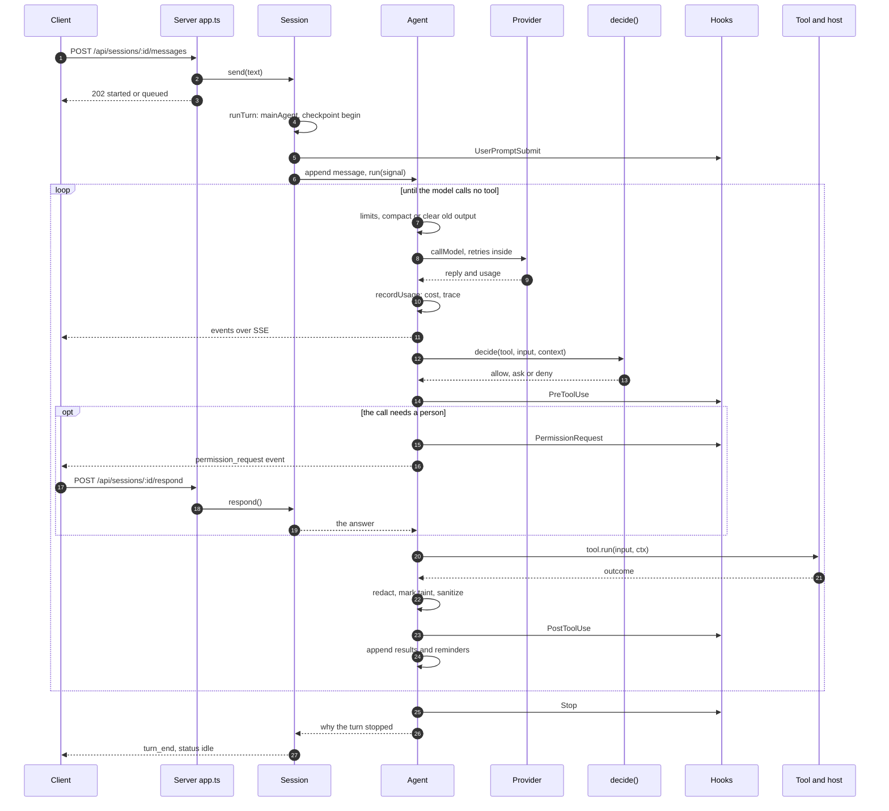

# Architecture

For developers who have never seen this project and want to understand how it works well enough to build on it or change it.

Facts that change (versions, models, prices, tool lists, plugin lists, settings and their defaults) are in [07-generated-reference.md](07-generated-reference.md), which is generated from the code. Features are described in [README.md](../../README.md), and what the harness cannot do is under "Honest limits" at the end of that file. If you want the short tour first, read [01-overview.md](01-overview.md).

## 1. The big picture

A harness is the program around a language model. The model only produces text and tool calls. The harness sends it the conversation, runs the tools it asks for, checks each call against permissions, keeps the record and counts the money.

The centre of this one is a single loop in `src/core/agent.ts`: call the model, run the tools it asked for, append the results, repeat until it answers without a tool call. Almost everything else in the repository feeds that loop, watches it, or shows what it did.



The layers, from the outside in:

| Layer | What it does | Where |
|---|---|---|
| Clients | Show conversations, send messages, answer questions. | `apps/desktop`, `ui/`, `src/cli.ts`, `packages/client` |
| Server | Signs people in and turns HTTP into calls on sessions. | `src/server` |
| Kernel | Assembles everything and holds the registry of what exists. | `src/kernel` |
| Core | Sessions, the agent loop, permissions, hooks, scheduling. | `src/core`, `src/agents` |
| Capabilities | Model providers, tools, where tools run, workflows, memory, vault, research, data. | `src/providers`, `src/tools`, `src/runtime`, `src/graph`, `src/gates`, `src/mcp`, `src/memory`, `src/vault`, `src/research`, `src/data` |
| Plugins | Everything else, added through the same calls the built-ins use. | `plugins/`, `solutions/` |

Who talks to whom:

- **Remote clients talk only to the server**, over HTTP and server-sent events (SSE: one long HTTP response the server keeps writing events to). Provider keys stay in the engine process, so such a client never sees one. The CLI and your own program skip the server and call `createHarness()` in their own process.
- **`createHarness()` in `src/kernel/harness.ts` builds the whole engine**: the registry, then plugins, then the companion hub, the MCP manager, the vault, the scheduler, the inbox and last the session manager. It returns a `Harness` object. The server, the CLI and your own program all start here.
- **Everything the harness can use is in the `Registry`** (`src/kernel/registry.ts`): models, providers, tools, agents, skills, gates, workflows, hooks, routes. The built-ins and plugins register through the same calls, so a plugin can do anything a built-in can.
- **An `Agent` knows two interfaces**: `Provider` to reach a model and `Tool` to act. Tools reach the workspace through a `ToolHost`.
- **Events flow outward.** An agent emits events, its `Session` numbers them, and subscribers receive them: SSE streams, the `EventHub`, plugins, the inbox and the noticer.

The same engine runs in several shapes: embedded in a program (`src/index.ts`), as a server (`src/server/main.ts`), as one command-line job (`src/cli.ts`), inside the desktop app, and from the signed kit in `kit/`.

### Why TypeScript runs uncompiled

Node strips TypeScript types as it loads a file, so nothing in `src/` is compiled. `npm start` runs `scripts/run.mjs src/server/main.ts`, which starts Node on the `.ts` file. The TypeScript compiler is used only to check (`npm run typecheck`, with `noEmit` in `tsconfig.json`). The minimum Node version is in [07-generated-reference.md](07-generated-reference.md).

What follows from that:

- **Only erasable syntax is allowed** (`erasableSyntaxOnly`): no `enum`, no `namespace`, no constructor parameter properties. Node can delete types, but it cannot generate code.
- **Imports name the real file**, extension included: `import { Agent } from './agent.ts'`.
- **A type error does not stop the program.** Only `npm run typecheck` finds it.
- **What runs is what was tested.** The desktop app's engine and the kit ship the same sources, not a build of them. `scripts/pack-kit.mjs` and `apps/desktop/electron/engine-host.ts` both rely on this. Electron's Node strips types too.
- **Node refuses to strip types inside `node_modules`.** That is why a kit must be kept outside any `node_modules` folder, and why a project links to it with `file:` dependencies.
- **Some things are still built.** `scripts/build.mjs` bundles the web UI and the companion (one file, `dist/companion.mjs`). The desktop's main process, preload and renderer are bundled too, by `apps/desktop/scripts/build.mjs`. Files there import without extensions, because a bundler reads them.

## 2. Where everything lives

```text
src/
  index.ts        the library's public exports
  cli.ts          one prompt from the terminal
  kernel/         createHarness, Registry, EventHub, provider keys, OpenTelemetry export
  core/           agent loop, sessions, permissions, provenance, hooks, settings, models,
                  checkpoints, recorder, scheduler, watches, inbox, noticing, linked sessions
  agents/         agent definitions, acceptance checks, verifier scorecards, a person's agents
  providers/      one file per model API, the Provider interface, shared streaming code
  tools/          built-in tools, the Tool interface, deferred groups, spill, shell-write guard
  runtime/        tool hosts: local, Docker, companion, OS sandbox, egress proxy, Windows jobs
  graph/          the workflow runner, its state, its validator
  gates/          running quality gates
  plugins/        loader, PluginAPI, signing, module resolution, bundles, UI files, test kit
  skills/         skill folders, packages, the skill builder
  mcp/            MCP client, servers, bundles, the harness as an MCP server
  memory/         notes that outlive a session
  vault/          the key vault and redaction
  research/       web search backends, stored sources, citation and claim checks
  data/           the DuckDB query engine, sources, semantic model, dashboards, published pages
  server/         HTTP API, accounts, single sign-on, workspace API
  companion/      the program that runs on a person's computer
  git/            worktrees, publishing branches and pull requests
  ops/            the change journal
  eval/           evaluation runner
  util/           atomic shared files, leases, sealed secrets, the harness home, zip
packages/
  client/         typed HTTP and SSE client, shared by the desktop and Node callers
  plugin-sdk/     types, runtime imports and test kit for plugin authors
  plugin-ui/      the UI contract: manifest, frame protocol, page SDK, plain-DOM UI kit
  ui/             the React design system and renderers the desktop uses
apps/desktop/
  electron/       main process and preload
  renderer/src/   the React shell, the registry of built-ins, frames
  shared/         types both sides use: prefs, product profiles, grants
  scripts/        build, packaging, end-to-end runs
ui/               the Preact web UI the server serves
plugins/          plugins that ship with the core
solutions/        domain packs, each a folder of plugins with its own version, tests and docs
products/         desktop product profiles and their public keys
kit/              what the signed local kit adds: its command, README, app template
docker/           sandbox images
scripts/          run, build, pack the kit, tests, the generated reference
test/             the test suite (node:test)
evals/, bench/    evaluation packs and benchmarks
examples/         example plugins and guide apps
docs/             these guides and design documents
```

## 3. The life of a message

This follows one message from the desktop, through a tool call, to the reply. A **session** is one conversation with its history and its **workspace**, the folder the agent works in. A **turn** is everything from a message to the agent's final answer. A **step** is one model call plus the tools it asked for, and a turn usually has many steps. The **context** is what the model is sent: the conversation so far, as the agent holds it.



**1. The client sends it.** The composer calls `packages/client/src/http.ts`, which posts to `/api/sessions/:id/messages`. In the desktop the address is `harness://app/api/...`. The main process forwards it to the engine and adds the token (`apps/desktop/electron/protocol.ts`).

**2. The server accepts it.** `route()` in `src/server/app.ts` signs the caller in, applies the rate limit, refuses an account over its daily spend (HTTP 429) and checks the account's limit on running turns. It then calls `Session.send()` and answers 202. The reply comes later, as events.

**3. `Session.send()` starts or queues** (`src/core/session.ts`). It notes the addresses and links the person typed (`notePersonText`), which the guard in step 7 reads. If a turn is running, the text joins `queued` and the agent sees it at its next step. Otherwise it takes the session's lease when several servers share the data folder (a lease is a small file saying which server drives the session), then calls `runTurn()`.

**4. `runTurn()` prepares the turn.**

- It sets `meta.running = true` and saves, so a crash can be noticed later.
- `mainAgent()` loads vault values, the host, the settings and the toolbox, and builds or refreshes the `Agent`. The system prompt comes from `systemPrompt()` in `src/core/prompt.ts`.
- `checkpoints.begin()` opens a file checkpoint for this turn.
- `UserPromptSubmit` hooks run and may block the message. A **hook** is a step the model cannot skip: a command, an HTTP call, a small model's judgement, an MCP tool, a verifying agent or a plugin function (`src/core/hooks.ts`).
- `/compact` and `/<skill>` are handled here.
- On the first message, `SessionStart` hooks run and `preamble()` builds the opening context: the environment, instruction files (`src/core/instructions.ts`), memory and the one-line list of skills. All of it goes in the first user message, never the system prompt (section 5 says why).
- `agent.append()` stores the message, then `agent.run(signal)` starts the loop.

**5. `Agent.run()` steps.** Before each model call it checks, in order:

- The step budget. With progress review on, this is a checkpoint rather than a wall (`src/core/progress.ts`): an agent on track is extended, a stuck one is reviewed, restarted from a handoff, or stopped with an account of why.
- `overBudget()`: the conversation's spend limit, a scheduled run's cap, an agent's cap, the account's daily cap.
- `maxTurnMinutes`, the wall-clock limit.
- **Context management**: `compact()` past the threshold, else `maybeClear()` (section 5).

**6. `callModel()` talks to the provider.** It builds a `ProviderRequest`, leaves out old images if a request would be too large (`capImages`), and calls `provider.send()`. Retries live here, not in the providers:

- A retryable `ProviderError` waits (the provider's `Retry-After`, else exponential backoff with jitter) and tries again, up to `MAX_RETRIES`. Each try emits a `retry` event.
- A provider that rejects an image: images are replaced by a note and the request goes on.
- A request that is too large (HTTP 413): images go first, then the conversation is compacted, then the person is told what to do.
- A sub-agent whose provider stalls repeatedly fails over (section 5).

Text streams out as `text_delta` events while the reply arrives. The finished message is appended, which writes it to `history.jsonl`, and `recordUsage()` runs. That is where **cost tracking** happens: `costOf()` prices the usage with the model's rate card, `onUsage` adds it to `meta.cost`, `meta.byModel` and the account's spend ledger, a `usage` event goes out, and a span goes to `trace.jsonl`. A tool that spends money outside the loop (a paid search) adds to the same total through `services.charge`.

If the reply has no tool calls, the loop checks for a reply cut off at the output limit, then for queued messages, then runs `Stop` hooks (or `SubagentStop`), which may send the agent back to work. Otherwise it ends with a reason such as `done`.

**7. `executeOne()` runs each tool call.** `executeAll()` runs consecutive `parallelSafe` calls together and everything else in order. For one call, in this order:

1. Find the tool. A dispatcher tool (`tool_call`) resolves to the real tool, and everything below applies to that one.
2. Refuse a tool whose plugin is off (`switchedOff`), bad JSON, or input that fails `validateInput`. These go back to the model as errors it can fix, not as failures of the turn.
3. `tool.refuse?.()` and the step's `toolBudget`.
4. **Permissions**: `decide()` in `src/core/permissions.ts`. A deny ends the call here.
5. **`PreToolUse` hooks.** A hook may block the call, or allow it and spare the prompt. Deny rules have already won.
6. **`auto` mode's check**: a small model compares the call with what the person asked. It never answers what the guard asks.
7. **`PermissionRequest` hooks**, then the person: `requestPermission` becomes a `permission_request` event, the session status becomes `waiting`, and `Session.respond()` resolves it when the answer arrives.
8. `tool.run(input, ctx)`, or `host.remoteTool` on a companion, wrapped in `watchdog()` so no call can hold the agent for good (`HARNESS_TOOL_MAX_MINUTES`).
9. The output is redacted (vault values become `[vault:name]`). If it came from outside, the agent is marked tainted and hidden text is stripped (`sanitizeUntrusted`).
10. `PostToolUse`, `PostToolUseFailure`, `FileChanged`, and `TaskCreated`/`TaskCompleted` hooks. Their feedback is added to the result. Instruction files of a subdirectory load the first time the agent touches it.
11. A very long result goes to a spill file (section 6), and a `tool_result` event and a trace span are written.

**The guard.** Two things carry this name, and they are different:

- **The untrusted-content guard** is part of `decide()`. An agent becomes **tainted** when outside content enters its context: a web page, a service's reply, a sub-agent that read some. A tainted agent's calls that could send data out, or that outlive the session, are asked about even when a rule or a mode would allow them. `src/core/provenance.ts` softens this: a call whose every destination the person named in their own messages is not asked about. It hardens it too: a message or payment to someone the person never named is asked even in `bypass` mode.
- **The shell-write guard** (`src/tools/shell-guard.ts`) makes the `bash` tool refuse commands that write file contents, so that writes go through `write` and `edit`, which keep checkpoints, diffs and edit permissions.

**8. The step closes.** Tool results, with their images, come first in the next user message. Harness notes in `<system-reminder>` tags follow, then anything the person typed. It is appended as one message, because providers want results first and the history must only grow. Then the loop repeats.

**9. The turn ends.** `runTurn()`'s `finally` block clears `meta.running`, answers leftover questions with a denial, emits `turn_end`, sets the status and saves. Waiting messages start the next turn. A linked session reports to its parent.

Where each concern happens:

| Concern | Function | File |
|---|---|---|
| Permission decision | `decide()`, called from `executeOne()` | `src/core/permissions.ts`, `src/core/agent.ts` |
| Hooks | `hookRun()` around every step above, `runHooks()` | `src/core/agent.ts`, `src/core/hooks.ts` |
| Untrusted-content guard | `decide()`, `sendsOut()`, `destinationsOf()` | `src/core/permissions.ts`, `src/core/provenance.ts` |
| Shell-write guard | `shellFileWrite()` in `bashTool.run()` | `src/tools/shell-guard.ts`, `src/tools/exec.ts` |
| Retries | `callModel()` | `src/core/agent.ts` |
| Context management | `compact()`, `maybeClear()`, `maskBatch()`, `capImages()` | `src/core/agent.ts` |
| Cost tracking | `recordUsage()`, `hooksFor().onUsage`, `overBudget` | `src/core/agent.ts`, `src/core/session.ts`, `src/core/models.ts` |
| Trace | `onTrace`, `Session.trace()` | `src/core/session.ts` |
| Redaction | `Agent.redact()`, `Session.emit()` | `src/core/agent.ts`, `src/vault/redact.ts` |

## 4. Sessions and durability

Everything durable is a plain file. There is no database. The harness home is `~/.harness`, or `HARNESS_HOME` (`src/util/home.ts`). Inside its data folder (`HARNESS_DATA` overrides where that is):

| Path | What |
|---|---|
| `sessions/<id>/meta.json` | The session's state: model, mode, runtime, cost, todos, `contextStart`, `running`. |
| `sessions/<id>/history.jsonl` | The main agent's conversation, one JSON message per line. |
| `sessions/<id>/trace.jsonl` | One record per model call, tool call, clearing and cache miss. |
| `sessions/<id>/checkpoints/` | File contents saved before changes, by turn. |
| `sessions/<id>/runs/` | Workflow run records. |
| `sessions/<id>/sources/` | Pages the agent searched or read. |
| `sessions/<id>/egress/allow.json` | The network allowlist, when the session has one. |
| `sessions/<id>/record/` | The tamper-evident record, when `record` is on (`src/core/recorder.ts`). |
| `workspaces/<id>/` | The default workspace of a session without its own folder. |
| `worktrees/`, `mirrors/` | Git worktrees, and server-side copies of companion folders. |
| `memory/`, `vault/`, `plugin-data/<name>/`, `plugins-state.json` | Memory, the key vault, plugins' own data, which plugins are off. |
| `schedules.json`, `schedule-runs.jsonl`, `inbox.json`, `paused-runs.json` | Proactive work. |
| `users.json`, `spend.json`, `companions.json`, `leases/` | Accounts, spend, companions, multi-server leases. |

Inside a workspace, `.harness/` holds the agent's working files: `spill/`, `bg/` (background shell logs) and `artifacts/`, beside the project's own `settings.json`, `agents/`, `skills/` and `workflows/`.

**Writes.** `meta.json` is replaced atomically (`writeFileAtomic` in `src/util/shared-file.ts`), and saves queue so two never share a temp file. `scheduleSave()` delays a save briefly to group changes.

**Append-only history.** `appendHistory()` adds lines and `Session.load()` skips a torn last line. A compaction appends the summary and moves `meta.contextStart` past the old messages, which stay in the file. Masking old tool output changes only the live copy of the context. So after a restart the context is rebuilt from `history.slice(contextStart)` with the originals.

There are two limits to keep in mind:

- `cutBefore()`, which goes back to edit an earlier message of the person's, rewrites the file. It is the one exception to append-only.
- Only the main agent's messages are stored. A sub-agent's context lives in memory and a restart loses it.

**Checkpoints** (`src/core/checkpoints.ts`). Before a tool first changes a file in a turn, `ctx.beforeWrite` saves it. `rewind(turn)` puts every file touched since back and removes files created since. Changes made by shell commands are not tracked, which is one reason for the shell-write guard. Files in a sub-agent's worktree are not covered either.

**What happens on a restart.** `SessionManager.load()` reads every session folder. For each one that no other server holds:

1. `recoverInterrupted()`: if `meta.running` is still true, the server stopped mid-turn. Every tool call without a result gets one saying it did not run, appended in order, so the transcript stays valid for the provider. The session is idle again and a notice says to send "continue".
2. `recoverRuns()`: a workflow run left `running` or `waiting` becomes `interrupted`. A run paused for a switched-off plugin keeps waiting.

Nothing carries on by itself unless `HARNESS_AUTO_RESUME=1`. With it, `resumeInterrupted()` (called by `src/server/main.ts` once the server is listening; a library calls it itself) runs `resumeAfterRestart()`: a cut-off turn starts again as a wake, and otherwise an interrupted run picks up at its node. Only one run carries on, and the others are listed for the person. The desktop does not set this variable.

**Background work and wakes.** Shells, sub-agents, workflow runs and monitors started in the background are tasks in a `TaskRegistry` (`src/tools/tasks.ts`). The task list is in memory: a restart forgets it, though background shells keep running and their logs stay in `.harness/bg/`.

When one finishes, `deliver()` queues its result as a reminder, fenced as data (wrapped in tags that mark it as content to read, not instructions to follow). If no turn is running, `autoWake()` starts one, so the agent carries on without the person. That is bounded. `wakeBlocked()` counts turns started without a message from the person (`meta.autoContinues`, reset when they write) against `HARNESS_BACKGROUND_MAX_WAKES`, and checks the account's caps. `HARNESS_BACKGROUND_WAKE=0` turns waking off. When blocked, the result waits for the next message and the person is told why.

**Outage retries.** A model call's own retries last minutes, while a laptop can lose its network for longer. With `HARNESS_AUTO_RESUME=1`, a turn or workflow run lost that way tries again later and later (`afterOutage()`, `OUTAGE_WAITS`). Each try is a wake, so a server in a crash loop cannot spend without end. `meta.outageRetries` and `meta.outageRun` survive a restart, and anything else ending the work clears them.

**Several servers on one data folder.** A session is driven by the server holding its lease (`src/util/lease.ts`), schedules by the holder of the scheduler lease. `takeLease()` runs before work starts and rereads the session if another server changed it. The limits are in [README.md](../../README.md) and running it is in [06-operating.md](06-operating.md).

## 5. Models and providers

**The interface** (`src/providers/types.ts`) is small:

```ts
interface Provider {
  send(req: ProviderRequest): Promise<ProviderResponse>;
  compactsServerSide?(model: ModelSpec, compactAt?: number): boolean;
}
```

`ProviderRequest` carries the model, system prompt, tools, messages, effort, a cache key, and streaming callbacks. `ProviderResponse` returns one `Message`, a stop kind, the `Usage`, and details of a compaction the provider did. Failures are `ProviderError`, with a `status` and a `retryable` flag the loop reads.

A provider's only job is to translate. `anthropic.ts` uses the official SDK. `openai.ts` speaks the Responses API, and `xai.ts` reuses it with a different `ResponsesFlavor`. `deepseek.ts`, `moonshot.ts` and `zai.ts` speak Chat Completions, and `compat.ts` drives any OpenAI-compatible server from data (`HARNESS_MODELS_JSON`). Providers on raw HTTP share `http.ts`, which parses the stream itself, so an abort cannot pass for a clean finish and a stalled stream is caught (`HARNESS_STREAM_IDLE_MS`, `HARNESS_CALL_MAX_MS`). Each assistant turn keeps its raw payload and is replayed exactly to the model or provider that wrote it. Anywhere else it is rebuilt from text and tool calls.

**How a provider is chosen.** A session has a model id (`meta.model`), and a `ModelSpec` (`src/core/models.ts`) names its provider. `Registry.provider(model)` returns a thin stand-in that looks the key up on every request, so a key set through the API works at the next request without a restart. The key comes from the environment first, then the vault (`Registry.keyInfo`). A plugin adds its own with `api.registerProvider` and `api.registerModel`.

Sub-agents use the model named by their definition, else `settings.subagentModel`, else the session's (`subagentModel()`). A model of another company receives the session's data, so an agent may choose one only if the person allowed it (`checkDelegation()`, `src/core/delegation.ts`).

**Caching.** Providers cache a prompt by its prefix: if a request begins with the same bytes as an earlier one, those tokens are read from the cache at a fraction of the price. The order is tools, then system prompt, then conversation. The harness is built around keeping that prefix identical:

- The system prompt is frozen and the same for every session. An output style or the client block is fixed when the session is made.
- Tools are sorted by name and fixed for the session, apart from deferred groups (section 6). A switched-off plugin's tool stays listed and answers with why it does not run.
- Everything that varies goes in the first user message. Later notes are appended as reminders, never inserted.

On Claude there is one explicit breakpoint on the system prompt, which also covers the tools, because tools render first. Automatic caching at the top level of the request covers the growing tail (`anthropicBody()`). With `promptCaching.prefixTtl` set to `auto` (`HARNESS_PREFIX_TTL`), the prefix moves to the 1-hour lifetime once the session shows gaps past the 5-minute one. OpenAI, xAI and Kimi route with `prompt_cache_key`. DeepSeek's cache is automatic, so its code only keeps the prefix byte-identical.

What breaks the cache, and how the harness limits it:

| Cause | Why it happens | What limits it |
|---|---|---|
| A tool list change | A deferred group loads. | Placed mid-conversation on models that allow it, once per group otherwise. |
| A model change | Another model has another cache. | Only when the person switches. |
| Editing earlier messages | Masking, clearing, images left out. | Rare, large batches. `capImages` keeps its choices, so history does not move each step. |
| Compaction | The context is replaced. | Reuses the cache for the summary request. |
| An effort change | Some APIs key the cache on it. | The Claude models in `MID_EFFORT` take it as a system message where it happened (`effortLog`). |
| Time | The entry expired. | The 1-hour prefix. |

`src/core/cache.ts` hashes each request's sections, so a miss names the first section that changed. It is recorded in the trace, in a `cache_miss` event and in `meta.cacheMisses`.

**Compaction** replaces a long context with a summary. `compactAt()` is the model's own point (`ModelSpec.compactAt`) or `HARNESS_COMPACT_AT`, capped below the window. The point is chosen for cost as much as for fit.

- *In the harness:* `compact()` sends the current context plus one appended instruction, with tools listed but not callable, so it reads the cache. The new context is a single user message: the preamble, the summary, the todo list, the latest user message and recently used skills. `PreCompact` hooks can say what must be kept.
- *On the provider's side:* where `compactsServerSide()` is true (Anthropic, and the OpenAI flavour of the Responses API), the provider summarises inside a request. The harness's own compaction is then a backstop at a higher threshold (`compactThreshold()`). `PreCompact` hooks run as the context nears the point, because there is no moment to ask during the request.

If an API refuses these beta features, the provider stops sending them and carries on.

**Context clearing** removes old tool output before compaction is needed. Claude does it on the server (`clear_tool_uses_20250919`), so the transcript stays append-only. For other providers `maskBatch()` replaces old results with a short placeholder saying what was there and how to get it back. It never touches recent steps, errors, or state such as todos, sub-agent reports and skills. Both act rarely and in large batches, because each one rewrites the cache after it. `efficiency.batchedMasking` turned off falls back to the older `maybeClear()` rule.

**Failover.** After repeated stalls on a provider, a sub-agent goes on with the conversation's own model, with its context intact, and says so (`failoverFor()`). That happens only when that model has a key and belongs to another company. The main agent has no failover: it retries, then the turn ends with an error (and outage retries may follow). A separate mechanism on some Claude models asks Anthropic's server to answer a policy refusal with another model (`fallbackOn()`, `HARNESS_ANTHROPIC_FALLBACK`).

## 6. Tools and hosts

**The `Tool` interface** is in `src/tools/types.ts`. The fields every tool has:

| Field | Meaning |
|---|---|
| `spec` | Name, description and JSON Schema input the model sees. |
| `kind` | The permission class (below). |
| `parallelSafe` | May run beside other parallel-safe calls in one step. |
| `remoteable` | Runs on the person's machine in a companion session. |
| `run(input, ctx)` | Does the work and returns a `ToolOutcome`. |
| `summarize(input)` | One line for permission prompts. |

Optional fields describe the call to the permission system: `kindsFor` (kinds that depend on the input), `sendsOut`, `persists`, `destinations`, `fetches`, `vaultNames`, `secretInputs`, `ruleSubject`, `alwaysAsk`, `refuse`, `untrusted`, `writesPath`. Others shape the tool list: `availableIn`, `defer`, `deferGroup`, `resolve`. A plugin may use `defineTool()` from `src/plugins/api.ts`, which fills in defaults (`kind` defaults to `exec`).

`ToolContext` (the `ctx` argument) gives a tool its host, the abort signal, the todo list, `beforeWrite`, `askUser`, `callTool` (run another tool with full permissions, used by `run_script`) and `services` (memory, sources, vault, tasks and others). A service that is off is absent.

**Kinds** decide what happens when no rule applies. Modes are `default`, `acceptEdits`, `auto`, `dontAsk`, `plan` and `bypass`.

| Kind | Means | Without a rule |
|---|---|---|
| `read` | No side effects. | Allowed. |
| `meta` | Talks to the harness or the person. | Allowed. |
| `edit` | Changes workspace files. | Asked in `default`, allowed in `acceptEdits`, `auto` and `bypass`, denied in `plan`. |
| `exec` | Runs commands. | Read-only commands and anything in a sandbox allowed, otherwise asked. |
| `network` | Fetches the web. | Asked, except in `bypass`. |
| `external` | Acts on another system. | Asked, denied in `plan`, allowed in `bypass`. |

`dontAsk` refuses whatever would be asked, and `auto` sends it to a checking model first. Rules come first: deny, then ask, then allow. The rule syntax is at the top of `src/core/permissions.ts`. Output of `network` and `external` tools counts as outside content.

The list of built-in tools is in [07-generated-reference.md](07-generated-reference.md). Some are made per session rather than registered: `agent`, `skill`, the task tools, MCP tools and the desktop tools (`Session.buildToolbox()`). A tool that could only fail here is left out, so it costs nothing in the prompt.

**Hosts.** A `ToolHost` (`src/runtime/host.ts`) is where tools touch files and run commands: `exec()`, `root`, `displayRoot`, `shell`, `sandboxed`, `networkPolicy`, and on some hosts `spawnStream` and `remoteTool`. `Session.getHost()` picks one from `meta.runtime`, and its `kind` is `local`, `docker` or `companion`. File tools confine paths with `resolveIn()` (`src/tools/paths.ts`), which follows links and refuses anything outside the root.

| Host | What it is | Boundary |
|---|---|---|
| `LocalHost` | A folder on the server's machine. | None by default: commands run with the server's account. Credential-like variables are removed from their environment (`scrubbedEnv`). Commands are asked about. |
| `LocalHost` with an OS sandbox | The same folder, commands wrapped by `wrapCommand()` in `src/runtime/os-sandbox.ts`. | bubblewrap on Linux, Seatbelt on macOS: writes confined, credential folders hidden, network off unless allowed. Windows has no such sandbox. |
| `DockerHost` | A container per session with the workspace at `/workspace` (`src/runtime/docker.ts`). | Capabilities dropped, memory, CPU and process limits. It stops when idle and restarts on demand. Works for a server folder too. |
| Companion host | A process on the person's computer (`CompanionHub.host()`). | Permissions are decided on the server. The companion is confined to its folder, and can use the OS sandbox or Docker there. |

`sandboxed` matters to permissions: in a sandbox the sandbox is the boundary, so commands are not asked about. Network is `none`, `full` or `allowlist`. An allowlist runs `src/runtime/egress-proxy.mjs`, as a container for Docker and a local process for the OS sandboxes. It can add API credentials the sandbox never sees. It does not intercept TLS, so over HTTPS it decides by host. `meta.effectiveNetwork` records what commands really have, because a folder without a sandbox has the machine's network whatever was asked.

Sandbox choice is `runtime.sandbox`, else `HARNESS_LOCAL_SANDBOX`, else off. Some of this has not been exercised on real machines, such as Seatbelt on a Mac. See "Not tested here" in [README.md](../../README.md).

On Windows, commands run in Git Bash when it is installed, else PowerShell (`resolveShell`), and each command gets a Job Object so a stop reaches all of it (`src/runtime/winjob.ts`).

**Deferred tool groups** (`src/tools/deferred.ts`). Every schema in every request costs tokens, and a coding turn calls no game or operations tools. So each plugin's tools form a group. Until something loads it, the request carries one line for it in the `load_tools` description. A group loads when the model calls `load_tools`, calls one of its tools by name (the call still runs), or loads one of the plugin's skills.

Loading is read from the history, not stored, so every request renders the same list and a load survives a compaction. The tools stay in the agent's toolbox the whole time: only schemas wait. A group too small to be worth a load stays inline (`GROUP_MIN_TOKENS`), and `efficiency.deferPluginTools` turns this off.

How a load reaches the provider differs:

- `midConversationTools()` declares every tool from the first request with `defer_loading` and adds each at the point it loaded, on the models in `MID_TOOL_CHANGES`.
- `responsesBody()` uses an `additional_tools` item on OpenAI.
- Kimi's newer models take tools inline (`inlineTools`).
- Models with `deferTools: false` (DeepSeek) get every tool from the start.
- Elsewhere the first load of a group changes the list, which costs one cache miss.

**Long output.** Past a tool's limit, output is kept whole in `<workspace>/.harness/spill/<session>/`, and the agent gets the head, the tail and the path (`src/tools/spill.ts`). Outside content is never spilled, because reading it back would lose its untrusted mark.

**MCP** (Model Context Protocol, a standard way to offer tools to an agent). Servers have scopes (`src/mcp/manager.ts`, `src/mcp/servers.ts`):

- **Server scope** is the operator's and plugins'. It is trusted and shared by every session.
- **Project scope** is a workspace's `.mcp.json`. It is repository content: nothing expands from the server's environment, and stdio servers run where the session's tools run.
- **User scope** is a person's own servers. Each tool's definition is pinned by hash, and a tool that later changes stays out until approved.

Up to `MCP_INLINE_MAX` tools are declared directly, as `mcp__server__tool`. Past that, the session declares only `tool_search` and `tool_call`, and schemas arrive as appended results, so the tool list never changes (`src/mcp/tools.ts`). MCP results always count as outside content. `.mcpb` bundles install through `src/mcp/mcpb.ts`. The other direction exists too: `POST /mcp` offers a person's agents as MCP tools (`src/mcp/expose.ts`), and `src/mcp/bridge.ts` does the same over stdio.

## 7. Multi-agent

Words used here:

| Term | Meaning | Where |
|---|---|---|
| Sub-agent | A new `Agent` with its own fresh context, started with the `agent` tool. It returns a report, not its transcript. | `Session.runAgent()` |
| Background agent | A sub-agent started with `run_in_background`. Its report arrives later as a reminder. | `startBackgroundAgent()` |
| Fan-out | One brief over many `items`, one agent each, one table back. | `fanOut()` in `src/agents/agents.ts` |
| Swarm | All agents of one run, under a charter. | `govern()`, `Charter` in `src/core/settings.ts` |
| Team | An agent definition with `team: {members, reviewer}`. It hands work only to its members. | `teamBrief()`, `asAgent()` |
| Linked session | A separate, full session that reports to the one that started it. | `src/core/linked.ts` |

**Sub-agents.** `runSubagent()` calls `runAgent()`, which builds a new `Agent` with `SUBAGENT_PROMPT`, the definition's tools, its own cache key per agent type, its own read stamps and the same redactor. Definitions come from the built-ins, plugins, the person's own (`src/agents/store.ts`), and `.harness/agents` or `.claude/agents` in the workspace. The types available are in [07-generated-reference.md](07-generated-reference.md).

Limits are in code, not in prompts:

- Sub-agents do not get the interactive tools (`INTERACTIVE_TOOLS`) and never get tools that outlive the run (`PERSISTENT_TOOLS`).
- They cannot write the project's agents, workflows, skills or settings (`CONTROL_PLANE_DENY`).
- They start their own sub-agents only up to `maxSubagentDepth`. A team lead may nest regardless, and `govern()` caps the depth.
- `maxParallelSubagents` limits how many run at once. A nested agent uses its parent's slot.
- An agent's `permissionMode` can only tighten the session's (`stricterMode()`).
- Taint moves both ways: a tainted agent's child starts tainted, and a tainted child taints its parent.

A sub-agent's cost goes to the session. `isolation: "worktree"` gives it a fresh git worktree on its own branch, kept and reported if it changed anything. `machine` places it on one of the person's computers. A sub-agent that runs out of steps gets one last call without tools to write its report (`wrapUp()`).

**Background work** is started only by the main agent: a sub-agent's `run_in_background` runs in the foreground. The person's Stop ends the turn and every background agent, workflow and monitor. Background shells keep running until `task_stop`.

**Swarms.** Each run gets a charter. `govern()` grants each agent or refuses it with a reason its lead hears: the number of agents, the rate, the spend, the time, how many one agent may start, and the same brief passed down as a loop. Past the agent limit the person is asked, once for a whole fan-out. Where nobody can be asked, it is refused. `stopSwarm()` is the kill switch. The design is in [SWARM.md](../swarm/SWARM.md).

**How agents talk: always through the lead.** There is no channel between siblings. The reason is in the README: the lead sees everything, and agents cannot loop on each other.

- `send_message` continues a sub-agent the caller started. A finished one runs again with its context intact, and a running one sees the message at its next step. `Session.sendMessage()` refuses any target the caller does not own. Only the last `KEEP_AGENTS` finished sub-agents are kept.
- `tell_lead` is the way up: a sub-agent tells whoever started it about a wrong premise or a block, at most `TELL_LEAD_MAX` times in a run. Its words are fenced as data, and it taints the lead if it is tainted.
- The person can also write to a running sub-agent (`messageAgent()`).

**Acceptance and verification** (`src/agents/acceptance.ts`). A lead can attach checks to a delegation, because a worker's own "done" is not evidence. `drive()` runs the loop:

1. A baseline of the workspace is taken before the work starts.
2. When the worker stops, the harness runs its `done_when` checks: a command, a file, something unchanged or absent. Existing tests are protected unless `may_change_tests` is set. A `hidden` check is never shown to the worker.
3. If they pass and `verify` is set, a verifier with a clean context reads the brief, the check results, the change set and the worker's report as claims (`verifyWork()`). It ends with a JSON verdict. A pass is overruled by a failed check, or if the verifier changed files itself.
4. Failures go back to the worker for a bounded number of fix rounds. The same failures twice stops early.
5. The report ends with what passed, what failed, and an outcome: accepted, unverified, not accepted or blocked. A worker can say `BLOCKED:` when a criterion is wrong, which goes to the lead instead of a fix round.

`stakes: "high"` puts the verifier on another provider where the person allows one (`crossModel()`, ordered by measured scorecards when they exist). `stakes: "critical"` also runs two replicas on two providers in separate worktrees and has a comparator read both (`runReplicas()`). Disagreement returns UNKNOWN with both, never a silent pick. Commands in checks run with the rights of the agent that wrote them (`permitCheck()`). `settings.verifyTurns` and a team's reviewer run the same verification on the main agent's turn, as a `Stop` hook (`turnVerifyHook()`).

**Linked sessions** are full sessions with `meta.parent`. `start_session` with `user_asked` starts one now. `offer` and `own_initiative` become a proposal the person starts or dismisses, and nothing runs before that. A child starts `fresh` with only its brief, or `fork` with the parent's conversation and cache key. Its reports reach the parent fenced, at its next step, and may wake it within `linkedSessions.maxAutoContinues`. `send_message` also takes a session id of the same account, and `hand_off` moves the task in progress to a fork.

Linked-session tools exist only where they are on (`linkedOn()`), so other sessions' prompts stay as they were. Depth is limited by `LINK_DEPTH`.

## 8. Workflows

A workflow is a graph: nodes do work and edges route on outcomes. It holds the parts a model should not decide: order, verification, human approval, retries with limits, resuming. Open-ended work happens inside agent nodes, each a full agent loop with a fresh context. As `src/graph/types.ts` puts it, graphs wrap loops, they do not replace them.

**The graph.** A `WorkflowDef` has a `start`, `nodes`, optional `inputs` and typed `state`. `next` on a node is a node id, or `{on: {outcome: id}, default}`. `validateWorkflow()` (`src/graph/validate.ts`) checks a graph before it runs: every edge points at a node, every node is reachable, an end is reachable, every state reference exists. `src/graph/format.ts` describes the format to an agent writing one.

| Node | What it does | Outcomes |
|---|---|---|
| `agent` | Runs a sub-agent with a templated brief. `decide` names verdict words, `outputs` asks for a JSON block of state fields, `toolBudget` caps a tool. | A `decide` word, `incomplete`, `invalid-output` |
| `gate` | Runs quality gates. | `pass`, `fail`, `exhausted` after `maxFailures` |
| `approval` | Asks a person, with files shown. | `approve`, `reject` |
| `shell` | Runs a command in the workspace. | `ok`, `fail`, `exit-N` |
| `parallel` | Runs branch nodes at once. | `all`, or a negative one |
| `map` | Runs an agent, shell or code step once per item, with `concurrency`. | `all`, `fail`, or a negative one |
| `branch` | Routes on a templated value, or a `when` condition on state and inputs. | The value, or `true`/`false` |
| `code` | A function. TypeScript workflows only. | What it returns |
| `end` | Ends the run, as `success` or `failed`. | |

No verdict is never approval: a report without a decision word counts as the conservative word, if the node has one (`conservative()` in `src/graph/runner.ts`).

**State.** `run.state` holds each node's output by node id. `run.values` holds typed fields declared in `WorkflowDef.state`. Each field has a reducer (`replace`, `append`, `merge`, `sum`), so writes from parallel branches and map items do not overwrite each other (`src/graph/state.ts`). Templates read `{{input.x}}`, `{{state.x}}`, `{{feedback}}`, `{{item}}`. The newest rejection or gate failure is `{{feedback}}` for the next node. Conditions use a small parsed expression language, not `eval`. Earlier work reaches an agent node as files in the workspace and short summaries, not as a growing transcript.

**Resume.** `WorkflowRunner.execute()` saves the run record after every node, to `sessions/<id>/runs/`. A run interrupted by a restart re-enters the node it was in, and that node runs again from its start, so nodes should be safe to repeat. A `map` node saves each finished item, so only unfinished items run again. `Session.resumeRun()` resumes runs that are `interrupted`, `aborted`, `failed` or paused.

A node that needs a switched-off plugin pauses the run (`pluginHold()`), and `src/graph/paused.ts` lists it so that switching the plugin on carries it on. Two caps stop a runaway: `MAX_STEPS` per execution and `maxAgentRuns` per workflow.

**Where workflows come from and how they start.** From plugins (`api.registerWorkflow`, or a folder of JSON), and from `.harness/workflows` in the workspace. A project's workflow with a `shell` node loads only where project commands are trusted. A run starts from the API (`startWorkflow()`), inside a turn through the `workflow` tool (`runWorkflowInline()`), in the background (`startWorkflowInBackground()`), or from a schedule.

**Gates** (`src/gates/gates.ts`) are verifiers plugins register with `api.registerGate`. A `QualityGate` has a name, a description, an optional `applies(host)` and a `run()` that returns a `GateResult`. A result with `severity: 'advisory'` warns without blocking. Gates run in three places: `gate` nodes, the agent's own `quality_gates` tool, and a `Stop` hook when `gatesOnStop` is set (`HARNESS_GATES_ON_STOP`), which will not let the agent finish while a blocking gate fails. Gates are bash commands, so under PowerShell `runGates()` fails on purpose rather than let every gate read as "does not apply". The list is in [07-generated-reference.md](07-generated-reference.md).

## 9. Plugins and the SDK

**What a plugin is.** A folder with a `harness-plugin.json`. The manifest alone can contribute skills, agents, workflows, output styles, MCP servers and hooks. A `main` file adds code: it default-exports `definePlugin({ setup(api) {...} })`, and `setup` registers tools, models, providers, gates, routes and the rest through `PluginAPI` (`src/plugins/api.ts`). A `ui` section adds pages to the desktop. Building one is covered in [04-build-your-system.md](04-build-your-system.md) and [the plugin SDK guide](../plugin-sdk/README.md).

**The load path** is in `createHarness()`:

1. `findPluginDirs()` lists folders from `opts.plugins` and the install folder. `src/server/main.ts` passes the shipped folders (`shippedPluginDirs()`) and `HARNESS_PLUGINS`.
2. Every plugin found becomes importable by name (`registerPluginDir`), then they are ordered so a plugin's `requires` load before it.
3. Solutions not installed here are held back, and plugins switched off are listed but no code of theirs runs.
4. `admit()` decides whether a folder may load, and how it is shown: shipped, signed by a known key, unsigned, or refused when a trust list is set and it does not verify.
5. `loadPlugin()` takes a registry snapshot, then `loadInto()` checks `engines.harness`, adds the declarative parts, imports `main` and awaits `setup(api)`. It is all or nothing: a failure restores the snapshot.
6. `registry.claim()` marks each part with its owner, so `switchedOff()` can answer for it later.

A plugin can be switched off, reloaded, updated and rolled back while the server runs (`PluginManager` in `src/kernel/harness.ts`). Open sessions keep their tool lists, for the cache, and a tool of a plugin that is off answers with why. A reload imports fresh code past Node's module cache (`src/plugins/fresh-import.ts`), and old tool objects then run the new code.

**Isolation.** A plugin's server code runs in the server process, with no process boundary around it. This is a limit by design, stated in the README. Declared permissions (`permissions.network`, `secrets`, `vault`, `sessions`, `routes`) are enforced on the channels the harness hands out: `api.fetch`, `api.secret`, MCP environments, hooks. Code that ignores those channels is not stopped. Signing is the control over which code may run at all. Plugin code never loads from a workspace: a repository contributes only declaratively, per session.

**How plugin code resolves the harness.** A plugin may be installed anywhere, even in a packaged app with no `node_modules`. `src/plugins/resolve.ts` adds a synchronous module hook (`module.registerHooks`):

| Import | Resolves to |
|---|---|
| `@harness/plugin-sdk`, `/runtime`, `/testing`, `/ui` | `packages/plugin-sdk/src` of this harness |
| `@harness/plugins/<name>/<file>` | That plugin's folder |
| `@harness/core/<path>` | The harness's own files. For tests: internals change between versions. |

The type-only import from `@harness/plugin-sdk` costs nothing at run time. `/runtime` is the stable way to reach helpers such as `defineTool` and `resolveIn`.

**How plugin pages reach the desktop.**

1. The manifest's `ui` section is validated against the contract in `packages/plugin-ui/src/manifest.ts`. The server sets a trust ceiling (`trustOf()`): `native` for shipped or trusted-signed plugins, else `frame`. A `uiHash` covers the section and its files.
2. The desktop reads `GET /api/plugins` and merges it with the built-ins and dev plugins in `buildRegistry()`.
3. A page is `declarative` (data the shell draws), a `frame` (the plugin's own HTML) or `native`. A native view looks up a React component in the entry's `native` module, and only the built-ins bring one, so a server plugin's own page is a frame.
4. A frame is a sandboxed iframe with an opaque origin, loaded from `harness://app/plugins/<name>/<file>`, which main proxies to `GET /api/plugins/<name>/ui/<path>` under a strict CSP. Only files under the frame entries' folders are served.
5. It has no network and no IPC. It talks to the shell by `postMessage`, in the `harness-ui/1` protocol (`packages/plugin-ui/src/rpc.ts`). `frame-host.ts` answers only methods the plugin declared and the person granted. A grant is tied to `uiHash`, so a change asks again. Some calls also need a click in the frame.
6. To reach its own server code, a frame calls `routes.call`, which goes to `/api/plugins/<plugin>/<path>` as the signed-in person.

**Signing** (`src/plugins/signing.ts`). A signature is Ed25519 over the SHA-256 of every file in the folder, `node_modules` included, in `harness-plugin.sig`. Links are refused. There are two lists:

- `HARNESS_PLUGIN_KEYS` is a trust list: with it set, every plugin that is not shipped must verify or it is refused.
- `HARNESS_PUBLISHER_KEYS` names official publishers: a plugin they signed is shown as official and gets native UI, and nothing else is refused because of them.

`tierOf()` gives each plugin `official` or `custom`, and both get the whole API. Installing from a catalogue needs a trust list. Importing a bundle needs one too, except on the person's own computer.

**Solutions** are packs of plugins in `solutions/<name>/`, each with its own version, tests, evals and docs. A plugin says it belongs to one with `"solution"` in its manifest. In `solutions: 'installed'` mode, which the server uses, only the ones installed here load. A solution can ship as one file with `harness-solution.json` and its plugins (`src/plugins/solution-bundle.ts`), checked and installed as a whole. `npm run plugins:bundles` writes the bundles and a catalogue index. The solutions are listed in [07-generated-reference.md](07-generated-reference.md).

**The kit** (`npm run kit`, `scripts/pack-kit.mjs`) is the engine sources, core plugins, SDK and production dependencies in one archive, every file signed. `harness verify` checks it. Its own `SECURITY.md` says plainly that a check run from inside the kit cannot stop someone who can rewrite the kit.

## 10. The server and the clients

**The HTTP API.** `createApp()` in `src/server/app.ts` is a plain `node:http` server with one `route()` function. It serves JSON under `/api/...`, sign-in under `/auth/...`, plugin routes under `/api/plugins/<plugin>/<path>`, `/mcp`, published dashboards under `/p/<slug>`, and the web UI. Session work is `/api/sessions/:id/<action>`: `messages`, `events`, `respond`, and others. `GET /api/health` answers before sign-in. `/api/version` reports `API_VERSION`.

Writes need the header `x-harness: 1`, which a cross-site page cannot send without a preflight the server never grants. `src/server/workspace-api.ts` is a person's own view of the workspace (file tree, writes, git status), confined like the agent's tools. A person's write tells the session (`userChangedFiles()`). The full API is in [README.md](../../README.md).

**Event streaming.** There are two SSE streams, both framed as `id: <seq>` and `data: {...}`:

- **Per session**, `GET /api/sessions/:id/events`. `Session.emit()` numbers each `HarnessEvent` (`src/core/types.ts`), redacts it and passes it to listeners.
- **Global**, `GET /api/events`: what a person may see across the server, from `EventHub` (`src/kernel/events.ts`). Topics include sessions, approvals, schedules, inbox and plugins, and `?topics=` narrows them.

Both replay after `Last-Event-ID` (or `?after=`) from a buffer in memory, and both send a comment as a keep-alive. Text deltas are live only and never enter the session's buffer. Buffers do not survive a restart, and numbering starts again. The durable record is `history.jsonl`, which clients read for a transcript. `packages/client/src/events.ts` reconnects from the last number seen and falls back to polling if the server has no global stream.

**Accounts.** With no accounts the server is single-user: whoever holds `HARNESS_TOKEN`, and that operator is an administrator. With accounts (`src/server/users.ts`, `users.json`), each person has a token, stored only as a hash, and is an administrator or a member. Members see only what they own. `src/server/oidc.ts` adds single sign-on without a dependency, and `src/server/desktop-auth.ts` adds sign-in for the desktop through the system browser. `SpendLedger` keeps daily spend per account, and `concurrencyLimits()` caps running turns and sandboxes. Sign-in can be turned off only on loopback (`HARNESS_AUTH=off`).

**How the desktop's engine runs.** `EngineHost` (`apps/desktop/electron/engine-host.ts`) forks `src/server/main.ts` in an Electron `utilityProcess`, run from source, on 127.0.0.1 with a free port and a random token. It waits for the server to answer, restarts it with backoff if it exits, and keeps the last log lines so the window can show the real error. Its data is the harness home, and the projects opened become `HARNESS_LOCAL_ROOTS`.

The window never sees the token. `protocol.ts` registers the privileged `harness://` scheme:

| Address | What |
|---|---|
| `harness://app/api/...`, `/auth/...` | Proxied to the engine, streamed both ways, token attached. Only the app's own fetches pass (`apiRequestAllowed`). |
| `harness://app/plugins/<n>/<f>` | A plugin's UI file, under the plugin CSP. |
| `harness://app/sdk/...` | The SDK frames load. |
| `harness://app/...` | The renderer's own files. |
| `harness://preview/<token>/...` | An artifact preview. |

A remote server goes through the same proxy with `RemoteEndpoint`, so renderer code is the same in both modes. Remote tokens are encrypted with the OS keychain through `safeStorage`.

**The companion** (`src/companion/`) lets a session work in a folder on someone's own computer. It makes only outbound requests: it long-polls `/api/companion/poll` and posts to `/api/companion/result`, so it needs no open port. Jobs are whole tool calls, commands, file operations and MCP messages (`CompanionJob`), run with the same tool code in `handler.ts`. Permissions and hooks run on the server first.

The companion holds an Ed25519 key of its own. The server pins it, and from then on every result must be signed (`src/companion/sign.ts`). A machine's policy for swarm work stays on the machine, and the server can never widen it. Vault values and calls that are asked every time are never sent to a companion. Tools that must run on the server use a mirror, which leaves out secrets and large files. Its limits are in [README.md](../../README.md).

The other clients are the Preact web UI in `ui/` and `packages/client`, the typed client the desktop uses. Details for a client author are in [README.md](../../README.md) under "HTTP API for desktop clients".

## 11. The desktop app

The desktop is a generic shell. Everything a person sees comes from plugins. The design is in [DESIGN.md](../desktop/DESIGN.md).

**Main process** (`apps/desktop/electron/`). `main.ts` loads the product profile, starts the engine or connects to a remote server, registers the scheme and owns the windows, tray, notifications, deep links and preferences. It names no feature. `ipc.ts` answers the window's requests by channel prefix, and `policy.ts` holds the scheme's rules as pure functions.

**Preload** (`preload.ts`). The only bridge. It exposes `invoke` and `on` over an allowlist of channel prefixes, and only to the app's own top frame. The window runs with `contextIsolation`, `sandbox: true` and no `nodeIntegration`.

**Renderer** (`apps/desktop/renderer/src/`). React, with zustand for state. `main.tsx` registers the built-ins, reads preferences and connects the event stream. `shell/` draws the sidebar, bars, command palette and overlays. `state/` holds app and server state.

**The registry of built-ins.** `builtins/index.ts` lists first-party plugins such as chat, settings, agents, artifacts and dashboards. Each declares a `ui` manifest, validated by the same rules as any plugin's. `buildRegistry()` in `registry/registry.ts` resolves every contribution from every enabled plugin into what the shell draws. It is pure and unit-tested, and the shell only reads it. `registry/reconcile.ts` says what must change when a plugin goes away, so nothing of it lingers. A product profile (`products/*.json`, `apps/desktop/shared/product.ts`) sets the name, brand, required plugins and sidebar order, so one core ships under several editions.

**Frames.** `registry/Frame.tsx` draws a plugin's page as an iframe with `allow-scripts allow-forms`, never `allow-same-origin`. `registry/frame-host.ts` is the host side of the protocol, a pure function so its refusals are unit-tested. It refuses in this order: not a well-formed call or no capability, no click when one is needed, bad arguments, the person declines. `TrustGate` asks for capabilities.

**Previews.** An HTML or React artifact that should run is registered with main (`preview.ts`) and framed from `harness://preview/<token>/`, on its own origin, sandboxed, with no network. Tokens are unguessable and held in memory.

**The UI kit.** There are two, for two kinds of page:

- `packages/ui` is the React design system for the shell and built-ins: components, icons, theme, and the renderers for Markdown, charts, diagrams, data, artifacts and dashboards.
- `packages/plugin-ui` is for plugin frames: `sdk.ts` for the protocol, and `kit.ts` with `kit.css`, plain-DOM components with no framework, so a page looks like the app with nothing to bundle.

**Agents that drive the app.** A session made with `client: {...}` gets a block in its system prompt saying which app it is and what it draws, fixed at creation (`src/core/client.ts`). The desktop tools (`src/tools/desktop.ts`) are forwarded to the app as `client_call` events, answered by `state/client-calls.ts` through `POST /api/sessions/:id/client-result`. They work only while the app is attached.

Plugin folders can be loaded in the app for development (`dev-plugins.ts`), and `dev-watch.ts` reloads them on change. Frame plugins at most: native UI is refused there.

## 12. Proactive work

This is work that starts without a message. All of it reuses sessions, so it goes through the same permissions and spend limits as a typed message. Details are in [README.md](../../README.md) and [PLAN.md](../proactive/PLAN.md).

**The scheduler** (`src/core/scheduler.ts`) keeps schedules in `schedules.json` and checks them on a timer (`tick()`). A schedule runs on a five-field cron, once at a time, by a trigger URL, or by a watch. It sends a prompt or a workflow, to an existing session or to a new one per run. The `Scheduler`'s runner is written in `createHarness()`.

- A busy session is skipped, and that is recorded.
- A missed run fires once after a restart, or is skipped (`misfire`).
- `maxCostUsd` caps one run (`capNextTurn()`).
- `beginUnattended()` marks the turn. What it asks waits in the person's inbox, then gets the safe answer, no.
- A session made for a run through the API defaults to `dontAsk`. The `schedule` tool's new conversations default to `auto`, where a checker approves safe steps and the rest wait. `asks` chooses otherwise.
- Each run is logged in `schedule-runs.jsonl`, followed to its end by `src/core/schedule-track.ts`.

**Watches** (`src/core/watch.ts`) run when something changes rather than at a time. A cheap check with no model (a command's output, files, git commits, a URL) runs every few minutes. Only a change fires it, optionally after settling and after a small model with no tools agrees it matters (`onlyWhen`). A quiet folder costs no model calls. What changed reaches the agent as data.

**Triggers** are secret URLs (`POST /api/triggers/<token>`), stored as a hash and shown once. What they bring is fenced as outside data and the session counts as having read untrusted content (`markUntrusted()`).

**The inbox** (`src/core/inbox.ts`) is one queue of what unattended work left for a person: `result`, `message`, `suggestion`, `digest`, `noticed`. Items are read, snoozed or dismissed with a reason, and responses go to a feedback log so usefulness can be measured. Whether an item also interrupts is decided by `decideAlert()` in `src/core/initiative.ts`, from the schedule's `notify` policy, quiet hours and a daily budget. What waits can go in a daily digest. A run ending with `NOTHING_TO_REPORT` leaves nothing.

**Noticing** (`src/core/noticing.ts`) finds things nobody set up a schedule for. Every session's events are counted into a log of fingerprints (hashes, never content). Fixed detectors read it at natural pauses, and no model watches. A finding passes cheap gates and only then reaches the person. It starts in `practice` mode: findings are written down, not shown, until the person turns it on. Dismissals only ever make it quieter, and a detector with mostly unwanted findings turns itself off. See [NOTICING.md](../proactive/NOTICING.md).

## 13. Knowledge and data

**Memory** (`src/memory/store.ts`) is plain Markdown the agent keeps through the `memory` tool, in two scopes: `/memories/user` (the person, every project) and `/memories/project` (keyed by git remote or folder). People can edit the same files. Memory reaches every future session, so it is guarded: paths are virtual and confined, sizes are capped, text that looks like a credential is refused, and changes are logged. `briefing()` loads it into the main agent's first message, fenced as notes, not instructions. After untrusted content a memory write is confirmed by a person (`Tool.persists`). Sub-agents do not write it. `HARNESS_MEMORY` sets `on`, `read` or `off`.

**Skills** (`src/skills/`) are folders with a `SKILL.md` and optional `scripts/`, `references/`, `assets/`, `tests/` and `mcp.json`. The context carries one line per skill until a task needs it, and then the `skill` tool loads it. `buildToolbox()` gathers skills from plugins, the person's library (`SkillStore`), the workspace and the harness's own, and a name is taken once. The most recently loaded skills are re-attached after a compaction (`skillsToKeep()`). `skill_script` runs a skill's scripts through the session's host. `check_skill` and `save_skill` let an agent keep a skill it made. Packaging is in [SKILLS.md](../SKILLS.md).

**Research.** `web_search` uses one backend for every model (`src/research/search.ts`, `HARNESS_SEARCH`). Plugins can add backends. `SourceStore` (`src/research/sources.ts`) keeps every page in the session's folder, where the agent cannot write, so a citation is only as good as the text actually fetched.

Two checks use it:

- `checkCitations()` (`src/research/citations.ts`) is deterministic. It catches a citation to a page never fetched, a quotation not in its source, and a figure not in the sources its sentence cites.
- The **claim ledger** (`src/research/claims.ts`) takes every cited sentence as a claim with its best passage. A judge, on another provider where one is allowed, sees only the sentence and the passage, and a "supported" must quote the passage word for word, checked against the stored page.

`plugins/research` builds the tools, gate, agents and the `deep-research` workflow on these. The harness can catch these failures. It cannot judge whether an argument is good.

**The data engine** (`src/data/`). Every number on a dashboard or in a report comes from a query DuckDB ran, and models never type numbers.

- `engine.ts` has two modes. Extracts turn a source into Parquet, with engine-written SQL only. Runs hold a person's or an agent's SQL, in a fresh in-memory database locked before that SQL is seen: no file but its extracts, no network, single `SELECT` statements, a row cap, a time limit.
- `sources.ts` reads files, databases, APIs and plugin data, with secrets from the vault.
- `semantic.ts` compiles measures and dimensions to SQL, applying row-level security first.
- `ops.ts` is the op layer: every change, from a click or a tool call, is a typed op, checked, applied atomically, versioned and undoable.
- `service.ts` runs queries, refreshes, alerts and subscriptions. `http.ts` serves `/api/data/*` and published pages.

Agents get `datasource`, `dataset`, `model` and `dashboard`, only where the app draws dashboards (`dataToolsFor()`). The dashboards' UI is the `core.dashboards` built-in. `answers.ts` applies the same rule to answers over a person's own database: read-only queries kept as cells, and every number in the answer must cite a cell. `plugins/data-answers` uses it.

## 14. Security in one paragraph

Permissions are enforced in code on every call, never by the prompt: deny rules win, a tainted agent's ways out are asked about, and after untrusted content even `bypass` asks before a message or payment goes to someone the person never named. Commands are contained by a sandbox where one is chosen, with an egress proxy for allowlisted networks, while a server folder without a sandbox runs with the account's access and is asked about instead. Secrets live in the key vault (`src/vault/`, sealed at rest or in an external backend), reach a command's environment without the model seeing them, and are replaced by `[vault:name]` in everything that leaves a session's memory. Outside content has hidden text stripped and is fenced as data. Plugin server code runs in the server process, so signing decides which code may run, while plugin pages run in sandboxed frames with capabilities a person granted, and the desktop's renderer never holds the engine's token. The boundaries, threats and limits are in [05-security-model.md](05-security-model.md).

## 15. Design decisions and why

- **The engine is not compiled.** What runs is what the test suite ran, in the repository, the desktop app and the kit alike.
- **One loop driven by the model, with graphs around it only where order matters.** Open-ended work needs a model's judgement. Verification, approval and retry limits should not depend on one (`src/graph/types.ts`).
- **Files, not a database.** A data folder can be read, backed up and moved, and several servers can share one with atomic writes and leases (`src/util/shared-file.ts`, `src/util/lease.ts`).
- **The system prompt is frozen and identical across sessions.** One cache entry serves them all, and most behaviour comes from tools and the loop rather than prose (`src/core/prompt.ts`). Project instructions go in the first user message for the same reason (`src/core/instructions.ts`).
- **History only grows, and reminders are appended.** Editing an earlier message rewrites the cache after it, and Claude's preserved-thinking check needs the history unchanged.
- **Clearing old output happens rarely, in large batches.** A clearing was seen to rewrite 130,000 cached tokens to save 3,000 (`src/providers/anthropic.ts`).
- **A choice to leave out an image stands.** Dropping one more old screenshot on each new one was about half of a screenshot-heavy session's bill (`capImages()`, and the changelog).
- **A switched-off plugin's tools stay listed and explain themselves.** The tool list is part of the cached prefix, so removing one would cost a full rewrite (`src/kernel/registry.ts`).
- **Errors go back to the model in a form it can act on.** Bad JSON, an unknown tool or a denied call is a tool result, not a failed turn (`src/core/agent.ts`).
- **Providers on raw HTTP parse their own stream.** An abort must never look like a clean finish, and a stalled stream must be caught (`src/providers/http.ts`).
- **Permissions are in code.** A prompt can be argued with, or overridden by what a page says (`src/core/permissions.ts`).
- **Shell commands may not write file contents.** Otherwise a sandboxed shell would be a way around undo, diffs, the stale-file check and "ask before edits" (`src/tools/shell-guard.ts`).
- **Destinations are matched exactly, on whole values.** Research code that matched substrings let `ob@company.com` pass for `bob@company.com` (`src/core/provenance.ts`, CHANGELOG).
- **Sub-agents talk only through their lead.** The lead sees everything, and agents cannot loop on each other.
- **A worker's "done" is checked by the harness and by a clean context.** Fix rounds are bounded because more rounds mostly add gaming, not passes (`Session.drive()`).
- **A verifier comes from another provider at high stakes.** One of the same family passes more of its mistakes (`verifyWork()`).
- **A charter limits every run.** Runaways of hundreds of agents were seen with nothing in the way, so going past the limit is the person's call (`src/core/settings.ts`).
- **Background results wake an idle session.** In a real run an agent said a job was running, ended its turn and sat idle until asked (CHANGELOG). Wakes are counted so sessions cannot keep each other going.
- **Failover goes only to the conversation's own model.** It is the one the person already chose, and only another company's helps, since the same one stalls alike (`failoverFor()`).
- **Plugin code runs in the server process**, as Claude Code's plugins do. That is why signing, not sandboxing, is the control. The boundary is chosen on purpose (README, "Honest limits").
- **Watching costs no model calls.** Watches and noticing use cheap checks and fingerprints, so a quiet day is free (`src/core/watch.ts`, `src/core/noticing.ts`).
- **The companion connects out.** No inbound port, and it works behind NAT (`src/runtime/companion.ts`).

## 16. Where to change what

| I want to change | Start in |
|---|---|
| How the loop steps, retries or ends | `src/core/agent.ts` |
| When a stuck agent stops or restarts | `src/core/progress.ts` |
| How a permission is decided | `src/core/permissions.ts` |
| What counts as a named destination | `src/core/provenance.ts` |
| A hook event or hook type | `src/core/settings.ts`, `src/core/hooks.ts` |
| Turns, wakes, restart behaviour | `src/core/session.ts`, `src/core/manager.ts` |
| The system prompt or opening context | `src/core/prompt.ts`, `src/core/instructions.ts`, `Session.preamble()` |
| Add a model | `src/core/models.ts`, or `HARNESS_MODELS_JSON`, or `api.registerModel` |
| Add a provider | A file in `src/providers/`, then `src/providers/index.ts`, or `api.registerProvider` |
| Caching on a provider | That provider's file, and `src/core/cache.ts` for attribution |
| Add a built-in tool | A file in `src/tools/`, then `BUILTIN_TOOLS` in `src/tools/index.ts` |
| Add a tool from a plugin | `api.registerTool` in the plugin's `main` |
| Which tools a session gets | `Session.buildToolbox()` |
| Deferred tool groups | `src/tools/deferred.ts`, `src/providers/tool-loads.ts` |
| Where commands run | `src/runtime/host.ts`, `docker.ts`, `os-sandbox.ts`, `Session.getHost()` |
| Network allowlists | `src/runtime/egress-proxy.mjs` |
| The agent tool, fan-outs, agent definitions | `src/agents/agents.ts` |
| Sub-agent limits and the charter | `Session.runAgent()`, `Session.govern()`, `src/core/settings.ts` |
| Acceptance and verification | `src/agents/acceptance.ts`, `Session.drive()`, `Session.verifyWork()` |
| Linked sessions | `src/core/linked.ts`, `src/tools/sessions.ts` |
| A workflow node type | `src/graph/types.ts`, `runner.ts`, `validate.ts`, `format.ts` |
| A quality gate | `plugins/quality-gates/`, or `api.registerGate` |
| The plugin API | `src/plugins/api.ts`, `src/plugins/loader.ts` |
| Plugin signing and trust | `src/plugins/signing.ts`, `admit()` in `src/kernel/harness.ts` |
| An HTTP endpoint | `route()` in `src/server/app.ts`, then `packages/client/src/http.ts` |
| A new event | `HarnessEvent` in `src/core/types.ts`, `src/kernel/events.ts`, `packages/client/src/types.ts` |
| Accounts and sign-in | `src/server/users.ts`, `oidc.ts`, `desktop-auth.ts` |
| The companion's jobs | `src/companion/handler.ts`, `src/runtime/companion.ts` |
| Engine start or the `harness://` scheme | `apps/desktop/electron/engine-host.ts`, `protocol.ts`, `policy.ts` |
| A desktop feature | `apps/desktop/renderer/src/builtins/` |
| The plugin UI contract or frame protocol | `packages/plugin-ui/src/manifest.ts`, `rpc.ts`, `apps/desktop/renderer/src/registry/frame-host.ts` |
| Schedules, watches, triggers | `src/core/scheduler.ts`, `src/core/watch.ts`, the runner in `createHarness()` |
| Inbox and interruptions | `src/core/inbox.ts`, `src/core/initiative.ts` |
| A noticing detector | `src/core/noticing.ts` |
| Memory, skills | `src/memory/store.ts`, `src/skills/skills.ts` |
| Search backends, citations, claims | `src/research/` |
| Dashboards and data | `src/data/ops.ts`, `src/data/semantic.ts`, `src/data/engine.ts` |
| The vault | `src/vault/store.ts`, `src/vault/redact.ts` |
| What is in the kit | `scripts/pack-kit.mjs`, `kit/` |
| The generated reference | `scripts/docs-facts.mjs`, never the file itself |
